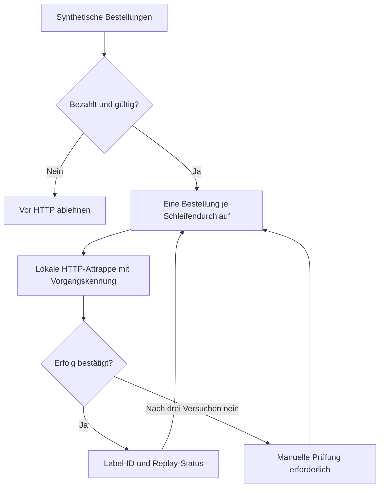

# Drei Minuten: vom Bestellereignis zum bestätigten Ergebnis

Ein lesbarer Projektrundgang mit reproduzierbarer Demo. Die Zeiten sind eine Orientierung zum Durchgehen; die erstmalige Installation von n8n ist darin nicht enthalten.

## 0:00–0:30 · Das Problem

Ein Shop sendet ein Bestellereignis zweimal. Oder der Versanddienst verarbeitet die Bestellung, aber seine Antwort geht verloren. Ein blindes Wiederholen kann dann einen zweiten Versandvorgang anlegen. Das Beispiel zeigt, wie fachliche Prüfung, eine stabile Vorgangskennung und ein bestätigtes Ergebnis zusammenwirken.

Alle Bestellungen und Labels sind synthetisch. [Die acht Eingaben](fixtures.mjs) lassen sich vollständig lesen.

## 0:30–1:15 · Den Ablauf lesen



Das Ledger im simulierten Dienst speichert Vorgangskennung, Daten-Hash und Label-ID. Bei einer Wiederholung mit denselben Daten kommt die bestehende Label-ID zurück. Abweichende Daten führen zu einem Konflikt. Der [n8n-Export](workflow.json) enthält einen echten HTTP-Request-Knoten und eine Schleife mit Batchgröße eins.

## 1:15–2:15 · Ausführen und das Ergebnis prüfen

Ohne zusätzliche Abhängigkeiten im Repository-Stamm:

```sh
npm test
npm run demo
```

Im Terminal erscheinen die acht Ergebnisse zweimal. Achte auf drei Dinge:

1. `happy` und `duplicate` haben dieselbe Label-ID.
2. `lost-response` endet trotz verlorener erster Antwort mit einem bestätigten Ergebnis.
3. Die Zahl neuer synthetischer Labels bleibt auch nach der zweiten Ausführung **3**; dauerhafter Fehler und Konflikt bleiben `manual_review`.

Der schnelle Befehl verwendet den Node-Prüflauf. Den tatsächlichen n8n-Import und seine Knotenausgaben belegen der [native Prüflauf](native-run.mjs), [sein Ergebnis](verification.json) und der CI-Job **native-n8n**. Die [Anleitung](README.md#den-echten-n8n-workflow-prüfen) beschreibt die Reproduktion.

## 2:15–3:00 · Die Entscheidungen hinterfragen

**Warum nicht nur „Ereignis schon gesehen“ speichern?** Ein Ereignis kann erneut zugestellt werden, und ein Dienst kann erfolgreich arbeiten, bevor die Verbindung abbricht. Deshalb steht der Geschäftsvorgang im Mittelpunkt, einschließlich gespeicherter Antwort und Konfliktprüfung.

**Was war beim Testen tatsächlich falsch?** Die erste n8n-Version verarbeitete mehrere Eingaben gemeinsam; spätere Fehler wurden nicht wie erwartet wiederholt. Der native Test schlug fehl. Die Verarbeitung einer Bestellung je Wiederholungsgrenze behebt diesen konkreten Fall; der Test prüft jetzt auch die Versuchszahlen.

**Was wäre der nächste Produktionsschritt?** Authentifizierte Shop-Anbindung, eine transaktionale Datenbank, ein echter Anbieteradapter, Monitoring und eine verantwortete Fehlerbearbeitung. Das lokale Ledger ist eine anschauliche Referenz und ersetzt diese Komponenten nicht.

[Zur ausführlichen Arbeitsprobe](README.md) · [Zum Profil](../../README.md)
