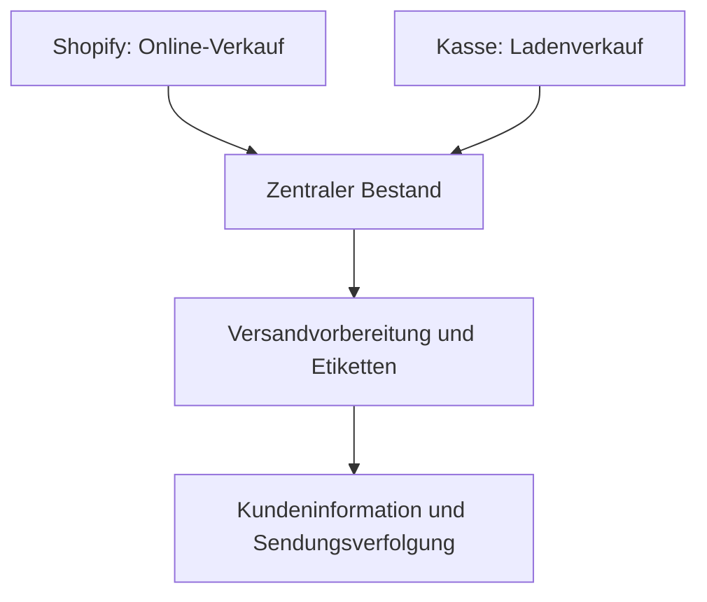

# Doctor K — E-Commerce und Prozessautomatisierung

**Praxisprojekt von Hassieb Kalla · Shopify, n8n und betriebliche Integrationen**

Für den familiennahen Handelsbetrieb hinter Doctor K habe ich Online-Shop, Ladenverkauf und wiederkehrende Betriebsabläufe miteinander verbunden.

## Ausgangslage

Online- und Ladenverkäufe sollten auf einen gemeinsamen Bestand zugreifen. Versand und Kundeninformation sollten als zusammenhängender Ablauf organisiert werden. Ein weiterer Ansatzpunkt waren bestehende E-Mail-Flows in Klaviyo.

## Mein Beitrag

| Bereich | Umsetzung |
| --- | --- |
| Verkauf und Bestand | Shopify-Shop aufgebaut, Kasse und zentralen Bestand für Online- und Ladenverkäufe verbunden |
| Versand | Versandvorbereitung, Etiketten, Bestandsabbuchungen und E-Mails mit Sendungsverfolgung automatisiert |
| Kundenkommunikation | Bestehende Klaviyo-Flows auf selbst gehostetes n8n übertragen |
| Interne Werkzeuge | Dashboard und interne Anwendung aufgebaut; KI-Telefonassistent für Beratungsanfragen umgesetzt |

## Der zusammenhängende Ablauf

Die Übersicht beschreibt den fachlichen Ablauf. Die technische Umsetzung muss zusätzlich mit Wiederholungen, fehlgeschlagenen Übertragungen und manueller Nacharbeit umgehen.

## Eine wichtige Entscheidung

Die Klaviyo-Flows wurden auf selbst gehostetes n8n übertragen. Dadurch lassen sich E-Mail-Abläufe mit weiteren internen Prozessen verbinden. Geringere Plattformkosten waren ein Ziel; dem stehen Hosting, Wartung und Fehlerbehandlung gegenüber. Eine belastbare Kostenbewertung muss diese Aufgaben mit berücksichtigen.

## Ergebnis und Einblick

Online- und Ladenverkäufe sind über den zentralen Bestand verbunden. Versandvorbereitung, Etiketten und Kundeninformationen wurden in zusammenhängende Abläufe übertragen; die wiederkehrenden E-Mail-Flows laufen über selbst gehostetes n8n. Eine Vorher-nachher-Messung von Zeitaufwand oder Gesamtkosten ist hier nicht veröffentlicht.

Im Gespräch kann ich den Zusammenhang der Systeme, meinen Anteil an der Umsetzung und die Prüfung der migrierten Abläufe erläutern. Ich entwickle mit KI-Unterstützung. Interner Code, Konfigurationen und Kundendaten bleiben privat; geeignete Einblicke sind nach Abstimmung möglich.

Die separate [n8n-Arbeitsprobe](../automation-demos/order-fulfilment/walkthrough.md) macht Wiederholungen und verlorene HTTP-Antworten mit synthetischen Daten nachvollziehbar. Sie ist ein Referenzbeispiel, kein Export des Kundensystems.

[Zurück zum Profil](../README.md) · [Musik-Automation](music-automation.md) · [Kontakt](mailto:info@mindrails.de)
