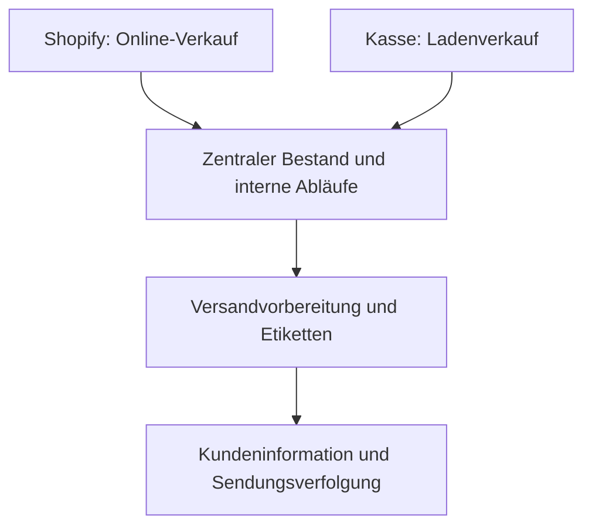

# Doctor K – E-Commerce und Prozessautomatisierung
**Praxisprojekt von Hassieb Kalla · Shopify, n8n und betriebliche Integrationen**

Für den familiennahen Handelsbetrieb hinter Doctor K habe ich Shopify, Kasse, Lager und wiederkehrende Kundenkommunikation miteinander verbunden. Ziel war, manuelle Arbeit zu reduzieren und Online- und Ladenverkäufe in zusammenhängenden Abläufen zu bearbeiten.

## Ausgangslage
Online-Shop, Ladenverkauf, Versand und Kundenkommunikation sollten als zusammenhängender Prozess organisiert werden. Wiederkehrende manuelle Schritte waren der Ansatzpunkt für die Automatisierung.

## Mein Beitrag
Mein Beitrag umfasst den Aufbau des Shopify-Shops, die Verbindung von Kasse und Bestand sowie interne Anwendungen und Automatisierungen. Bei der Entwicklung nutze ich KI-Unterstützung, unter anderem Claude Code. Ein Schwerpunkt war die Übertragung bestehender Klaviyo-Flows auf selbst gehostetes n8n.

## Umsetzung
| Bereich | Projektbeitrag |
| --- | --- |
| E-Commerce | Shopify-Shop aufgebaut |
| Kasse und Lager | Kassensystem und zentralen Bestand für Online- und Ladenverkäufe verbunden |
| Interne Abläufe | Dashboard und interne Anwendung aufgebaut |
| Versand | Versandvorbereitung, Etiketten, Bestandsabbuchungen und E-Mails mit Sendungsverfolgung automatisiert |
| E-Mail-Workflows | Bestehende Klaviyo-Flows auf selbst gehostetes n8n übertragen; geringere Plattformkosten waren ein Ziel der Umstellung |
| Telefon | KI-Telefonassistent für Beratungsanfragen umgesetzt |

## Fachlicher Ablauf
Vereinfachte Übersicht, kein technisches Deployment-Schema:

Die Automatisierung verbindet einzelne Arbeitsschritte: Bestellungen, Bestandsveränderungen, Versand und Kundeninformation werden gemeinsam betrachtet. n8n übernimmt wiederkehrende E-Mail-Abläufe; der Telefonassistent ergänzt die Kundenkommunikation.

## Ergebnis

Online- und Ladenverkäufe sind über den zentralen Bestand verbunden. Versandvorbereitung, Etiketten und Kundeninformationen wurden in zusammenhängende Abläufe übertragen. Wiederkehrende E-Mail-Flows laufen über selbst gehostetes n8n.

Der beschriebene Nutzen liegt in verbundenen Systemen und weniger einzeln auszuführenden Arbeitsschritten. Diese Fallstudie enthält keine veröffentlichte Vorher-nachher-Messung von Arbeitszeit oder Gesamtkosten; deshalb leite ich daraus keine bezifferte Einsparung ab.

## Entscheidung und technische Abwägung

Ein konkreter Teil der Umsetzung war die Übertragung bestehender Klaviyo-Flows auf selbst gehostetes n8n. Damit lassen sich E-Mail-Abläufe mit weiteren internen Prozessen verbinden. Zur Bewertung dieser Entscheidung gehören neben Plattformgebühren auch Hosting, Wartung und Fehlerbehandlung. Eine Gesamtkostenrechnung ist hier nicht veröffentlicht.

## Für ein technisches Gespräch

Anhand dieses Projekts lassen sich drei konkrete Fragen besprechen:

- Wie hängen Verkauf, Bestandsänderung, Versandvorbereitung und Kundeninformation zusammen?
- Welche Aufgaben habe ich beim Shop, bei der Verbindung der Systeme und bei der Migration der E-Mail-Flows übernommen?
- Wie wurden die migrierten Abläufe geprüft, und wie werden Fehler oder manuelle Nacharbeiten erkannt?

Diese Fragen sind ein Leitfaden für das Gespräch. Interne Konfigurationen, Abnahmeprotokolle und Fehlerbehandlung sind in diesem öffentlichen Repository nicht als Quellcode belegt.

## Was ich im Gespräch zeigen kann
Ich erläutere gern den Bestellablauf, die Migration von Klaviyo zu n8n und meinen konkreten Anteil an den Integrationen. Geeignete Einblicke in interne Anwendungen können nach Abstimmung gezeigt werden.

**Veröffentlichungsumfang:** Projektbeschreibung aus eigener Arbeit; interner Quellcode und Kundendaten bleiben privat.

[Zurück zum Profil](https://github.com/haskallalk-eng) · [Musik-Automation](music-automation.md) · [Kontakt](mailto:info@mindrails.de)
